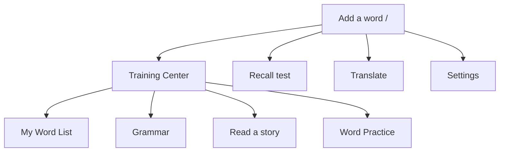

2026-11-17 Welcome dual-entry visibility fix (fix/welcome-dual-entry-visible-20261117): the real first-visit Welcome React screen (src/ui/Landing.tsx at /) now renders two always-visible top-level entry cards before the showcase iframe: Lingo3 App calls the existing open/session flow; Lingo3 Academy navigates directly to /academy.html. This removes reliance on controls inside the embedded /showcase.html iframe. Existing showcase links remain as secondary entries. No workspace route changes. Back from Academy returns normally through browser history or Welcome link.

2026-11-17 Academy specification integration (feat/academy-two-entrances-20261117): /academy.html now mirrors the uploaded Online Teaching Platform structure at public-site level: How it works; courses/formats; CEFR levels/placement placeholder; verified-teacher directory placeholder; pricing/package model; real email-based trial/meeting enquiry; local-only My Notes; Learning Space architecture (overview/progress, session history, homework/materials, tests/results, shared notebook, vocabulary/flashcards, messages, calendar); Student/Teacher/Admin portal architecture; sample Practice; resources; references; contact/legal readiness. Live vs planned capabilities are explicitly labelled. No production Academy auth roles, DB Learning Space, calendar slot engine, payments, video, teacher records, or RLS are claimed as implemented. Welcome remains dual gateway App → / and Academy → /academy.html. Back behavior is browser history plus Welcome link. Code review reference: public/showcase.html + public/academy.html, commit 3623fe8.

2026-11-17, feat/academy-two-entrances-20261117: Welcome /showcase.html now has two equally visible entry cards: Lingo3 App → / (existing auth/workspace), Academy → /academy.html (top-level navigation from iframe). Academy adds #booking email-based enquiry (not confirmed booking) and #notes local-only save/export; #teachers no verified trainers, #courses formats planned, #practice sample questions. No shared Academy account data, teacher calendar, live meeting, or payment implemented. Back uses normal browser history; return Welcome link available. Reviewed public/showcase.html and public/academy.html. Deployment/browser functional checks pending.

2026-11-17 Academy follow-up (branch feat/academy-website-navigation-20261117): Welcome iframe Academy links now use target=_top to navigate the whole browser. /academy.html opens directly with no required language selection; UI language selector remains optional; #teachers lists only verified instructors (currently none), #courses shows planned formats, #practice provides browser-local interactive sample questions, #resources is planned material, / routes to existing Lingo3 sign-in. No teacher booking, payments, authenticated Academy classroom, or database persistence. Existing app routes unchanged. Browser Back returns to prior page; Academy Welcome links /showcase.html. Review code: public/showcase.html, public/academy.html.

## 2026-11-17 — Academy foundation (proposed)
Reviewed version 0.7.5; branch feat/academy-foundation-20261117; code public/academy.html and public/showcase.html.

Public welcome /showcase.html → existing Lingo3 app / (unchanged) OR Academy /academy.html. Academy has public sections #match (four-language selection), #courses (planned private, groups up to 3, online), #resources (planned trainer materials), #contact (email). Academy top Login returns to existing Lingo3 auth entry; it is NOT a dedicated Academy login or authenticated Academy portal. Back via Welcome → /showcase.html or browser history. No student/trainer roles, bookings, payments, meeting links or content authoring are active.

# Lingo3 — page and section map

Reviewed: 2026-11-09. App version: 0.7.5.
Code reference: base main `dfa536ed7197aa7de6aa3698859f79cb5adcbb56`; branch `feat/review-card-removal`; `src/ui/Training.tsx`, `Review.tsx`, `WordCard.tsx`, `src/App.tsx`.
Review scope: highlighted information button opens full native/active-learning-language details from Word Practice and Recall. Bottom Remove offers tests-only suspension (manual practice retained) or personal-list soft removal; shared bank retained. Restore to tests available for suspended words. Detail Back returns to the current activity; recall removal skips the word without grading/counting it. Paths/primary menus unchanged.

## Active workspace

Workspace screens require sign-in when auth is configured. All five primary tiles are rendered by HomeTiles. Training children have a return-to-center control and sibling shortcuts. Recall/Word Practice use focus layout; their Home/exit action returns to Add a word. The logo also returns home.

| Section | Path | Purpose / access |
|---|---|---|
| Add a word | / | Input, source-language selector, shared-bank expansion followed by AI fallback, save for later |
| Training Center | /training-center | Hub with Home and four activity tiles |
| My Word List | /words | Saved words/list management; reached from Training Center |
| Grammar | /grammar | Personal grammar notes/rules for active learning languages |
| Read a story | /read | Vocabulary/story practice |
| Word Practice | /review | Explore words without changing recall schedule |
| Recall test | /recall | Scheduled recall; primary tile with due count |
| Translate | /translate | Translation workspace |
| Settings | /settings | Account, progress, profile, language, audio, scheduling, backup and help controls |

Settings subsections observed in source: Account (Sync), Your progress, You, Languages (Learning), Recall, Audio, Scheduling, Full backup, Help & About (guide/About). AdminPanel is nested in Settings and controls its own eligibility; it is not a public top-level route. No access change was made in this batch.

## Public and conditional entry

| Entry | Status | Purpose / return |
|---|---|---|
| /showcase.html | Active public | Product information; App Login/Open app returns to existing app entry |
| /privacy | Active public | Policy displayed before session gate; Back goes to / |
| /invite/<name> | Active public entry | Inviter-aware first-visit landing; opening app returns to / |
| Sign-in / password recovery | Conditional screens | Session/recovery state, not dedicated new paths; recovery Done resumes app |

## Compatibility and planned work

Existing child URLs /words, /grammar, /read and /review remain direct-linkable after grouping under Training Center. /review intentionally means Word Practice, while /recall means scheduled Recall test; these are not swapped links.

Stored-form bank optimization is active in batch 010. RLS regression fixtures passed; physical signed-in browser acceptance and the optional shared-vocabulary administration UI remain pending. No new page, feature tile, deleted page or role permission was introduced. Technical route details and Back behavior are in ROUTE_INDEX.md.
