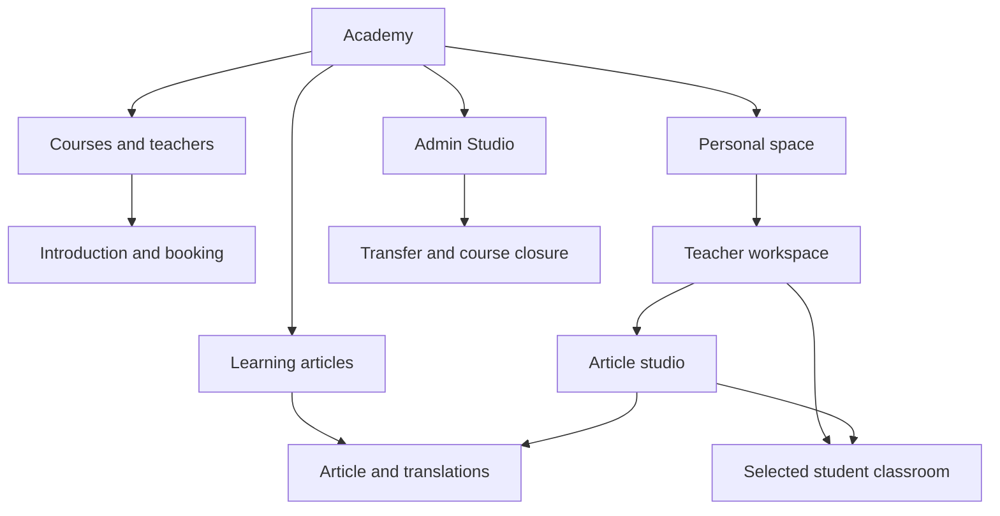
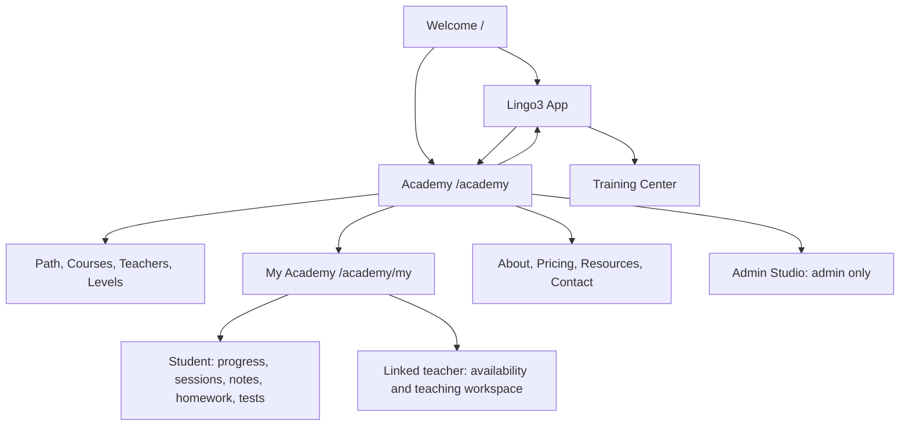
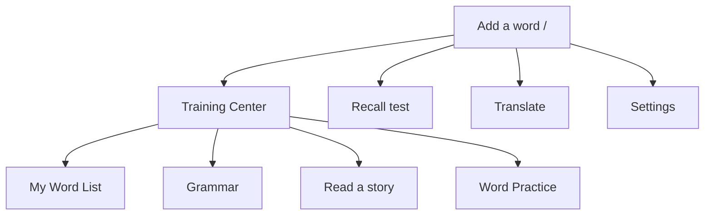

2026-11-19 · v0.7.5 · reviewed bc38fb9 + release patch on feat/academy-student-workspaces-20261119. This section supersedes historic route descriptions below.

| Route | Access / behavior |
|---|---|
| `/academy/posts?lang=fa` (also en/sv/de) | Public learning articles, only published translation matching locale; category filter |
| `/academy/posts/:id?lang=fa` | Public stable article URL; available translation links; missing/unpublished translation returns server 404/noindex |
| `/academy/courses/:id?lang=…` | Public course introduction, syllabus, duration/price and offering teachers; booking retains teacher/course |
| `/academy/teachers/:id?lang=…` | Public teacher introduction, courses and anonymous free/busy calendar |
| `/academy/levels` | Compatibility redirect to `/academy/courses`; no menu entry |
| `/academy/my` | Authenticated; teacher roster → selected student → notes/messages/resources/homework/progress. Personal teacher desk; article editor; admin teacher/student switch. Own isolated demo student view. Noindex |
| `/academy/admin` | Admin only: users, enrollments, impact-checked course closure/teacher transfer, editors. Noindex |
| `/sitemap.xml` | Public dynamic XML, public course/teacher URLs and published article translations only |
| `/api/academy-page` | HTML/XML rendering endpoint, anonymous reads only; not a navigation entry |

Back: directory/detail links use shared SPA history, browser Back restores previous route. Article translation URLs preserve article identity. Post Studio lives inside Teacher Space (admins can select Teacher Space); student sharing stores a snapshot without publishing the draft. Existing App routes and single shared auth session remain unchanged. Reviews are prepared but disabled; domain-email delivery remains unconfigured, not active.

2026-11-18 release verification: production source f9c8408bb3fa3032f6d4e77413b56df430d2fffb, deployment dpl_B6U7WtmEWWveDn1ugR2yUkQfa3zf. Vercel build completed in 41s; live lingo3.com serves index-CIUEiV-3.js / Academy-67xfYk_A.js containing new admin roster, group scheduling and calendar RPCs. Admin/my/teachers routes returned HTTP 200. PR #56 is draft; source not merged to main. New signed-in/viewport browser E2E remains unverified: local Chromium failed with socket Operation not permitted. SQL fixture cleanup verified zero test users. This delivers roster/scheduling foundation, not all remaining Academy scope.

2026-11-18 · v0.7.5 · branch feat/academy-class-management-20261118, source base 6b00c4 + current patch. This entry supersedes older release-status entries below. Seven new migrations (20261118172726–20261118220631) applied successfully. Frontend source f9c8408 deployed; see release verification above.

Navigation review: no top-level routes removed or added. /academy/admin → collapsed Users/access (paged search, teacher profile, admin grant/revoke, user enrollments), Students/enrollments (assign, pause, activate, complete, reversible remove), Course editor/list, Teacher editor/list → assigned courses and students. /academy/my → collapsed Classes/schedule → membership requests, one-time/daily/weekly sessions, attendance, cancellation requests, meeting links and notifications. Admin teacher view can manage existing group classes. /academy/teachers → request lesson dialog → sanitized free/busy calendar, occupied options disabled; existing student classroom has teacher calendar. Teacher workspace retains single and recurring weekly availability. Browser Back routes unchanged; inline details expand/collapse without history entries. New group UI implemented in this branch; advanced makeup/shared group coursework remain planned.

2026-11-18 · v0.7.5 · based on 41e49ac. Training Center now links to /academy alongside its activities. Online navigation requests fresh HTML; offline navigation can use the precached app shell. No route removed.

2026-11-18 · v0.7.5 · Academy navigation, based on 70a0f9a. Groups open with click, tap or keyboard, stay open during pointer movement, and close with selection, outside click or Escape. Mobile uses one column. Routes and browser Back behavior unchanged. Preview release only until required Supabase migrations are verified.

2026-11-18 · v0.7.5 · Teams/Zoom manual meeting links, based on 5b4d1fc. /academy/my Teacher Space has private reusable links and per-booking primary/backup selection; Student Space displays participant links for confirmed/in-progress bookings. Paths and Back behavior unchanged. Apply 20261118050000 then 20261118131500 before production deployment. Supabase rehearsal confirmation expired. Automatic provider creation and embedded video remain pending.

2026-11-18 · v0.7.5 · reviewed 8e3a388 and role-view patch. /academy/my offers Student Space and Teacher Space to admins. Other signed-in accounts see their own role view. Opening a classroom from Admin Studio selects Teacher Space. URLs and browser Back behavior are unchanged.

2026-11-18 navigation acceptance review · v0.7.5 · source cd4d705 + navigation/UI patch (feature branch). Paths unchanged. Login and booking are same-URL history overlays: Back/Escape/Close dismiss, Forward restores; successful login consumes login overlay; successful booking replaces overlay with /academy/my. Product navigation discards overlay state. Settings remains same-URL history overlay. No new active production feature.

2026-11-18 follow-up route review · version 0.7.5 · source 5fcd5da + preference/sharing integration patch. No paths, entries, roles or Back behavior changed; existing map verified against App.tsx, Academy.tsx and AcademyBridge.tsx. Feature branch only; not production-live.

2026-11-18 source review · version 0.7.5 · branch fix/academy-complete-workflows-20261118; base main 91fa6f7. Reference: src/App.tsx, src/academy/*, src/ui/Landing.tsx, src/ui/AcademyBridge.tsx. Implemented in feature source; NOT production-live. No top-level route added/removed. / is now the compact App + Academy introduction; the legacy /showcase.html remains available but is not embedded on the homepage. Academy Settings is a same-route overlay: browser Back/Escape closes it. App shortcuts support ?academyLang=<code>; grammar resource import additionally uses ?academyResource=<resource-id>. These query parameters preserve personal learning-language settings. Shared notes/homework/messages are reachable from the selected classroom for both students and active assigned teachers. Admin Studio lists all enrollment statuses and opens the chosen classroom. Tests-only scripts/qa paths are not production routes. Planned provider integrations remain labelled planned.

# Current App and Academy map

Reviewed: 2026-11-17 · Version 0.7.5 · Code: merged PR #53 and #54; main `a5a2c9c8338dcb9f2ea1ab90f9e110a49f338d32` (`src/App.tsx`, `src/academy/*`, `src/ui/GrammarManager.tsx`).

Current review: App and Academy share one session. App has a primary Academy tile; Academy has a direct App shortcut. Browser Back/Forward uses SPA history. Teacher dashboard is restricted to linked teachers; Admin Studio requires admin access. Student learning data requires sign-in and enrollment. Native date/time inputs retain labels; editable text fields show guidance. No route was added or removed in this QA release.

Implemented external-link support: manual meeting and learning-resource URLs. Planned: automatic Teams meetings, external calendar sync, payments, hosted video, binary uploads, automated placement tests and realtime notebook. Recorded test results are teacher-entered history, not an automated testing engine.

Previous review history follows; this current review supersedes earlier release-status statements.

2026-11-17 release QA update — branch `feat/academy-role-dashboards-20261117`. Responsive review covered phone, portrait tablet and laptop breakpoints in source: Academy navigation now collapses through 860px, mobile controls have 46px minimum touch height, tablet learning grids remain two-column where space permits, cards wrap long URLs/text safely, and form fields now include example placeholders/guidance (native date/time fields use explicit labels/title because browsers do not render reliable placeholders). The production Supabase migration `20261117211500_academy_role_dashboards.sql` was dry-run in a transaction and then applied successfully. Verified: Academy languages, session summaries and test-results tables; test-results RLS with policies; admin user lookup; privacy-safe teacher calendar; Control Center Academy RPCs; canonical resource kinds. Security Advisor showed only the expected guarded SECURITY DEFINER exposure for the new connector/RPC functions and no new missing-RLS or mutable-search-path finding. Control Center CI is green; Lingo3 latest CI is still pending GitHub runner at the time of this documentation commit. Vercel deployment attempt is currently blocked by Free plan daily deployment quota (HTTP 402 api-deployments-free-per-day), so production UI is not yet claimed live.

2026-11-17 · Academy role-dashboard implementation (branch `feat/academy-role-dashboards-20261117`, not deployed): App primary navigation now includes an Academy mosaic tile. Academy `/academy/my` becomes role-aware: normal authenticated users see a compact per-language student dashboard; linked teachers see the Teacher workspace instead of the student dashboard; admins retain management access. Student cards surface progress, last/next session, latest teacher note, open homework, note count, latest test result foundation, plus App shortcuts to `/words` and `/grammar`. Teacher workspace surfaces profile/contact/course context, weekly free/booked slots with student labels, students, progress/plans, lesson/grammar/link resources and homework. Admin Studio gains secure user search/selection for teacher linking. Database migration `20261117211500_academy_role_dashboards.sql` is prepared but NOT applied; it adds test-result history, expands resource kinds, admin-only user lookup, and token-guarded Control Center Academy operations. No production deployment or database change was performed in this batch.\n\n2026-11-17 · Academy routed-pages + theme review: `/academy` is Home; dedicated SPA routes now exist for Path, Courses, Teachers, Levels, My Academy, Admin, About, Pricing, Resources and Contact. All retain the one shared Supabase SessionState and keep App Dexie out of Academy. Academy defaults to Light theme and offers a persisted Light/Dark toggle. Browser Back/Forward follows Academy route history.\n\n2026-11-17 · Academy Google OAuth return hardening: Academy and App continue to use one shared Supabase account/session. Google OAuth now returns through the established root `/` redirect and stores a short-lived same-tab intent for `/academy`; after Supabase restores the shared session, App performs same-document navigation back to `/academy`. No separate Academy Google OAuth client/domain is required. Email/password login remains in-place in the Academy modal. No top-level route was added or removed; browser Back behavior is unchanged after the post-auth product restore. Reviewed against `src/auth/useSession.ts`, `src/App.tsx`, and `src/auth/SignIn.tsx`.\n\n2026-11-17 · Academy mobile/German navigation review (fix/academy-mobile-german-20261117). No URL or Back-behavior change. `/academy` keeps the same Learn / My Academy / About information architecture, but on screens ≤650px the sticky header now collapses behind a hamburger control instead of wrapping all top-level items; opening a section keeps grouped dropdowns inside the mobile panel and section selection closes the panel. Academy UI language now supports EN/SV/DE/FA; German is LTR and Persian remains RTL. German is also available as a learnable subject alongside Swedish, English and Persian. Admin course/teacher editors now accept German titles/descriptions/topics/introductions. `↑` remains the fixed return-to-top control.

2026-11-17 · Shared App/Academy auth-session navigation fix (fix/shared-auth-session-app-academy-20261117). Reviewed App Home, Welcome/showcase, Academy menu and browser Back behavior. Runtime URLs remain unchanged, but product switching is now same-document SPA navigation: Welcome → Academy, App Home → Academy, and Academy → Lingo3 App use history.pushState/popstate rather than full-page reload. App Home now includes a bottom Lingo3 Academy entry card. Academy retains a permanent Lingo3 App item in My Academy. Browser Back/Forward moves between product surfaces through normal history. Shared Supabase identity remains one account/user bank; Academy still does not mount the App Dexie lifecycle while on /academy.

2026-11-17 · Development-memory documentation review (docs/ai-development-memory-20261117). Application page/section structure and Back behavior were re-checked; this documentation-only change adds no route, page, menu or role-access change. Added canonical AI development context/history/roadmap files and CI documentation checks only. Runtime route map remains unchanged: shared Welcome/App at /, interactive Academy at /academy, compatibility redirect /academy.html, showcase /showcase.html, and existing App workspace routes.

2026-11-17 · Lingo3 Academy real MVP review (feat/academy-real-mvp-20261117). Code reference: src/academy/Academy.tsx, AcademyBookingDialog.tsx, AcademyPortal.tsx and Supabase Academy migrations 20261117160000–165000. Route structure is unchanged: / remains the shared Welcome/App gateway, /academy is the interactive Academy, and /academy.html remains a compatibility redirect. Active Academy sections now include public Learning Path/Courses/Teachers/Levels, real trial booking requests, and authenticated My Academy operations: Student bookings/session status, private Learning Space goals/progress/notes, material/homework links and text submissions, teacher feedback, private Student↔Teacher messaging; linked Teacher accounts additionally get internal availability/calendar slots, booking confirmation/cancellation/completion/no-show, student progress/next-session planning and material/homework authoring. Admin Studio still manages courses, teachers, teacher-course assignment and enrollment activation; activation is now atomic. Top Learn/My Academy/About menus and Back/browser history behavior are unchanged. Planned/not active: automatic Teams meeting creation, Google/Microsoft calendar sync, payments, hosted video, binary file upload, placement/test engine and realtime collaborative notebook. No fake teacher records were added.

2026-11-17 production verification — Academy stability/navigation audit: PR #46 merged as 6c2cc4e2a608b1df5981176d653a3ba87eeb26ed. Production deployment dpl_9VQZnpcHGLc9XpqN6DMXYztcxtvb is READY with aliasError null and aliases lingo3.com, www.lingo3.com, lingu3.vercel.app and Vercel main aliases. Live checks: /, /academy, /academy.html, /showcase.html and /showcase.js all HTTP 200; /academy.html redirects to /academy; showcase links to /academy; served showcase.js has no ResizeObserver or resize feedback listener and contains height de-duplication. Main fixes: Academy is routed before LingoApp so App Dexie/IndexedDB lifecycle does not run on /academy; Welcome iframe resize feedback removed; dead legacy Landing implementation removed; grouped Academy menus auto-close on another menu, section selection and mouse leave; typography normalized; personal Learning Spaces scoped to current student and admin interest queue filtered/capped. Added docs/LINGO3_APP_ACADEMY_GUIDE.md and check:academy regression coverage. Physical Chromium click E2E remains unavailable from this environment because external browser navigation is blocked with ERR_BLOCKED_BY_ADMINISTRATOR; no physical-browser claim is made. Existing unrelated api/grammar-examples.ts TypeScript diagnostics still appear in Vercel post-build logs but do not block the READY deployment.

2026-11-17 · Academy stability/navigation hardening (fix/academy-stability-navigation-20261117). Reviewed App/Academy/Welcome routing and repeated-entry risk. Key fix: /academy is now routed by top-level App() before LingoApp mounts, so Academy no longer opens the App Dexie database or starts App-only local DB lifecycle. Welcome iframe resize feedback loop removed (no child ResizeObserver/window-resize height echo); parent ignores <=2px height churn. Unreachable legacy Welcome implementation removed from Landing.tsx to reduce bundle/work on repeated entry. Academy top grouped menus now close when another opens, after section selection, and on mouse leave. Academy typography normalized (hero/section/card sizes reduced from oversized ranges). Academy personal Learning Spaces are now scoped to the logged-in student's rows even for admin users; admin pending enrollment query is filtered to interested and capped at 200. Added docs/LINGO3_APP_ACADEMY_GUIDE.md and npm run check:academy regression checks. No route removals; /academy.html remains compatibility redirect. External provider integrations unchanged.

2026-11-17 production verification: Academy expansion from PR #45 is live from code commit 804626e37287cfaea8b69fb2b1cd8c00b160162e. Vercel production dpl_GQ6z1sMazzybrF8fXyYc84tcCtPp is READY and mapped to lingo3.com. Live HTTP checks: /academy -> SPA shell 200 with current production asset; /academy.html -> compatibility redirect page to /academy; / -> shared Lingo3 shell 200. Supabase live verification: 6 active starter courses, 0 active teachers (intentionally no invented teacher profiles), 0 enrollments/learning spaces/bookings before real user activity. Sitemap/route behavior reviewed against production.

2026-11-17 · Lingo3 v0.7.5 · Academy platform expansion (feat/academy-platform-phase1-3-foundation-20261117). Verified implementation reference: src/academy/Academy.tsx, src/academy/academy.css, src/App.tsx, src/auth/SignIn.tsx, public/showcase.html, public/academy.html, Supabase migrations 20261117133000/134000/140500. /academy is now the interactive Academy route using the shared Lingo3 Supabase session; legacy /academy.html redirects to /academy. Public Academy: compact sticky grouped navigation, Find Learning Path hero, EN/SV/FA full UI switching with Persian RTL, DB-backed course catalogue and topic lists, formats (1-to-1 online, online group up to 3, offline introduction), teacher directory, teacher contact fields (email/phone/Teams chat/Teams call/Telegram), assigned teacher courses, level guide, About/How/Pricing/Resources/Contact, trial request. Personal space: student enrolments, teacher assigned courses, private Learning Space progress and notes. Admin-only Studio (user_settings.is_admin): create/edit multilingual courses, delivery modes, pricing, Telegram; create/edit teachers, picture/intros/languages/levels/specialties/contact, link teacher account, assign courses; review interested enrolments, assign teacher, activate enrolment and create Learning Space. Active capabilities are DB/RLS-backed. No fake teachers are seeded. Automatic Teams meeting creation, provider calendar availability, payments, video hosting, file upload/homework/test engines and realtime shared notebook are NOT claimed active; links/data fields and secure platform foundations exist for later provider integrations. Browser Back works normally; fixed ↑ button returns to top; sticky header compacts while scrolling.

2026-11-17 Academy routing correction (fix/separate-academy-route-and-root-welcome-20261117): root / is now the shared Welcome gateway for both Lingo3 App and Lingo3 Academy, including returning/signed-in browser users. Enter App continues into the existing app/session flow; Enter Academy navigates to the standalone static /academy.html. vercel.json SPA rewrite now excludes academy.html, showcase.html and PWA/static metadata; Workbox navigateFallbackDenylist also excludes Academy/showcase so the App service worker cannot replace them with index.html. Existing internal app routes remain unchanged. This fixes Academy links opening the App and ensures both destinations are visible from the same Welcome.

2026-11-17 Welcome dual-entry visibility fix (fix/welcome-dual-entry-visible-20261117): the real first-visit Welcome React screen (src/ui/Landing.tsx at /) now renders two always-visible top-level entry cards before the showcase iframe: Lingo3 App calls the existing open/session flow; Lingo3 Academy navigates directly to /academy.html. This removes reliance on controls inside the embedded /showcase.html iframe. Existing showcase links remain as secondary entries. No workspace route changes. Back from Academy returns normally through browser history or Welcome link.

2026-11-17 Academy specification integration (feat/academy-two-entrances-20261117): /academy.html now mirrors the uploaded Online Teaching Platform structure at public-site level: How it works; courses/formats; CEFR levels/placement placeholder; verified-teacher directory placeholder; pricing/package model; real email-based trial/meeting enquiry; local-only My Notes; Learning Space architecture (overview/progress, session history, homework/materials, tests/results, shared notebook, vocabulary/flashcards, messages, calendar); Student/Teacher/Admin portal architecture; sample Practice; resources; references; contact/legal readiness. Live vs planned capabilities are explicitly labelled. No production Academy auth roles, DB Learning Space, calendar slot engine, payments, video, teacher records, or RLS are claimed as implemented. Welcome remains dual gateway App → / and Academy → /academy.html. Back behavior is browser history plus Welcome link. Code review reference: public/showcase.html + public/academy.html, commit 3623fe8.

2026-11-17, feat/academy-two-entrances-20261117: Welcome /showcase.html now has two equally visible entry cards: Lingo3 App → / (existing auth/workspace), Academy → /academy.html (top-level navigation from iframe). Academy adds #booking email-based enquiry (not confirmed booking) and #notes local-only save/export; #teachers no verified trainers, #courses formats planned, #practice sample questions. No shared Academy account data, teacher calendar, live meeting, or payment implemented. Back uses normal browser history; return Welcome link available. Reviewed public/showcase.html and public/academy.html. Deployment/browser functional checks pending.

2026-11-17 Academy follow-up (branch feat/academy-website-navigation-20261117): Welcome iframe Academy links now use target=_top to navigate the whole browser. /academy.html opens directly with no required language selection; UI language selector remains optional; #teachers lists only verified instructors (currently none), #courses shows planned formats, #practice provides browser-local interactive sample questions, #resources is planned material, / routes to existing Lingo3 sign-in. No teacher booking, payments, authenticated Academy classroom, or database persistence. Existing app routes unchanged. Browser Back returns to prior page; Academy Welcome links /showcase.html. Review code: public/showcase.html, public/academy.html.

## 2026-11-17 — Academy foundation (proposed)
Reviewed version 0.7.5; branch feat/academy-foundation-20261117; code public/academy.html and public/showcase.html.

Public welcome /showcase.html → existing Lingo3 app / (unchanged) OR Academy /academy.html. Academy has public sections #match (four-language selection), #courses (planned private, groups up to 3, online), #resources (planned trainer materials), #contact (email). Academy top Login returns to existing Lingo3 auth entry; it is NOT a dedicated Academy login or authenticated Academy portal. Back via Welcome → /showcase.html or browser history. No student/trainer roles, bookings, payments, meeting links or content authoring are active.

# Lingo3 — page and section map

Reviewed: 2026-11-09. App version: 0.7.5.
Code reference: base main `dfa536ed7197aa7de6aa3698859f79cb5adcbb56`; branch `feat/review-card-removal`; `src/ui/Training.tsx`, `Review.tsx`, `WordCard.tsx`, `src/App.tsx`.
Review scope: highlighted information button opens full native/active-learning-language details from Word Practice and Recall. Bottom Remove offers tests-only suspension (manual practice retained) or personal-list soft removal; shared bank retained. Restore to tests available for suspended words. Detail Back returns to the current activity; recall removal skips the word without grading/counting it. Paths/primary menus unchanged.

## Active workspace

Workspace screens require sign-in when auth is configured. All five primary tiles are rendered by HomeTiles. Training children have a return-to-center control and sibling shortcuts. Recall/Word Practice use focus layout; their Home/exit action returns to Add a word. The logo also returns home.

| Section | Path | Purpose / access |
|---|---|---|
| Add a word | / | Input, source-language selector, shared-bank expansion followed by AI fallback, save for later |
| Training Center | /training-center | Hub with Home and four activity tiles |
| My Word List | /words | Saved words/list management; reached from Training Center |
| Grammar | /grammar | Personal grammar notes/rules for active learning languages |
| Read a story | /read | Vocabulary/story practice |
| Word Practice | /review | Explore words without changing recall schedule |
| Recall test | /recall | Scheduled recall; primary tile with due count |
| Translate | /translate | Translation workspace |
| Settings | /settings | Account, progress, profile, language, audio, scheduling, backup and help controls |

Settings subsections observed in source: Account (Sync), Your progress, You, Languages (Learning), Recall, Audio, Scheduling, Full backup, Help & About (guide/About). AdminPanel is nested in Settings and controls its own eligibility; it is not a public top-level route. No access change was made in this batch.

## Public and conditional entry

| Entry | Status | Purpose / return |
|---|---|---|
| /showcase.html | Active public | Product information; App Login/Open app returns to existing app entry |
| /privacy | Active public | Policy displayed before session gate; Back goes to / |
| /invite/<name> | Active public entry | Inviter-aware first-visit landing; opening app returns to / |
| Sign-in / password recovery | Conditional screens | Session/recovery state, not dedicated new paths; recovery Done resumes app |

## Compatibility and planned work

Existing child URLs /words, /grammar, /read and /review remain direct-linkable after grouping under Training Center. /review intentionally means Word Practice, while /recall means scheduled Recall test; these are not swapped links.

Stored-form bank optimization is active in batch 010. RLS regression fixtures passed; physical signed-in browser acceptance and the optional shared-vocabulary administration UI remain pending. No new page, feature tile, deleted page or role permission was introduced. Technical route details and Back behavior are in ROUTE_INDEX.md.
