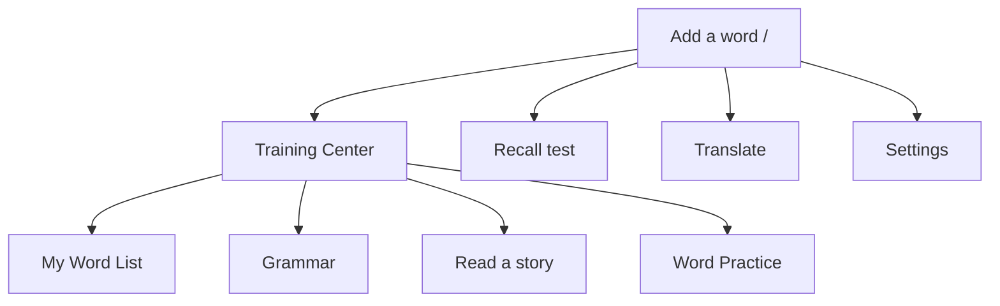

# Lingo3 — page and section map

Reviewed: 2026-11-08. App version: 0.7.3.
Code reference: main `8e42f3261dc6992a728985290c58ea946f401719`; sources `src/App.tsx`, `src/ui/SettingsPanel.tsx`, `public/showcase.html`.
Review scope: existing navigation for vocabulary batch 009; no route/UI changes.

## Active workspace

Workspace screens require sign-in when auth is configured. All five primary tiles are rendered by HomeTiles. Training children have a return-to-center control and sibling shortcuts. Recall/Word Practice use focus layout; their Home/exit action returns to Add a word. The logo also returns home.

| Section | Path | Purpose / access |
|---|---|---|
| Add a word | / | Input, source-language selector, shared-bank expansion followed by AI fallback, save for later |
| Training Center | /training-center | Hub with Home and four activity tiles |
| My Word List | /words | Saved words/list management; reached from Training Center |
| Grammar | /grammar | Personal grammar notes/rules for active learning languages |
| Read a story | /read | Vocabulary/story practice |
| Word Practice | /review | Explore words without changing recall schedule |
| Recall test | /recall | Scheduled recall; primary tile with due count |
| Translate | /translate | Translation workspace |
| Settings | /settings | Account, progress, profile, language, audio, scheduling, backup and help controls |

Settings subsections observed in source: Account (Sync), Your progress, You, Languages (Learning), Recall, Audio, Scheduling, Full backup, Help & About (guide/About). AdminPanel is nested in Settings and controls its own eligibility; it is not a public top-level route. No access change was made in this batch.

## Public and conditional entry

| Entry | Status | Purpose / return |
|---|---|---|
| /showcase.html | Active public | Product information; App Login/Open app returns to existing app entry |
| /privacy | Active public | Policy displayed before session gate; Back goes to / |
| /invite/<name> | Active public entry | Inviter-aware first-visit landing; opening app returns to / |
| Sign-in / password recovery | Conditional screens | Session/recovery state, not dedicated new paths; recovery Done resumes app |

## Compatibility and planned work

Existing child URLs /words, /grammar, /read and /review remain direct-linkable after grouping under Training Center. /review intentionally means Word Practice, while /recall means scheduled Recall test; these are not swapped links.

Bank latency optimization, complete RLS/browser acceptance, and an optional shared-vocabulary administration UI are **not delivered** by batch 009. No new page, feature tile, deleted page or role permission was introduced. Technical route details and Back behavior are in ROUTE_INDEX.md.
