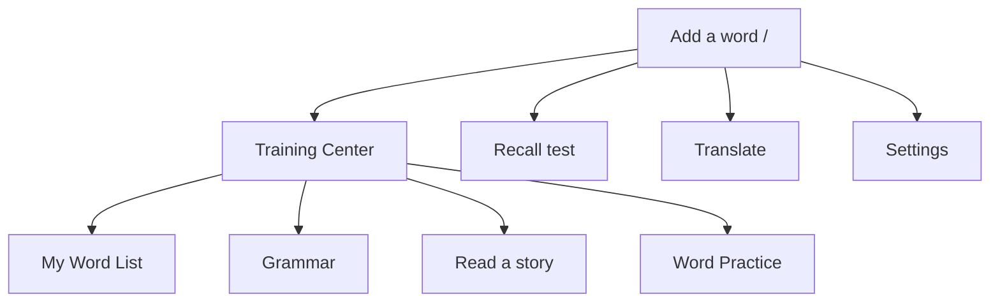

2026-11-17 · Shared App/Academy auth-session navigation fix (fix/shared-auth-session-app-academy-20261117). Reviewed App Home, Welcome/showcase, Academy menu and browser Back behavior. Runtime URLs remain unchanged, but product switching is now same-document SPA navigation: Welcome → Academy, App Home → Academy, and Academy → Lingo3 App use history.pushState/popstate rather than full-page reload. App Home now includes a bottom Lingo3 Academy entry card. Academy retains a permanent Lingo3 App item in My Academy. Browser Back/Forward moves between product surfaces through normal history. Shared Supabase identity remains one account/user bank; Academy still does not mount the App Dexie lifecycle while on /academy.

2026-11-17 · Development-memory documentation review (docs/ai-development-memory-20261117). Application page/section structure and Back behavior were re-checked; this documentation-only change adds no route, page, menu or role-access change. Added canonical AI development context/history/roadmap files and CI documentation checks only. Runtime route map remains unchanged: shared Welcome/App at /, interactive Academy at /academy, compatibility redirect /academy.html, showcase /showcase.html, and existing App workspace routes.

2026-11-17 · Lingo3 Academy real MVP review (feat/academy-real-mvp-20261117). Code reference: src/academy/Academy.tsx, AcademyBookingDialog.tsx, AcademyPortal.tsx and Supabase Academy migrations 20261117160000–165000. Route structure is unchanged: / remains the shared Welcome/App gateway, /academy is the interactive Academy, and /academy.html remains a compatibility redirect. Active Academy sections now include public Learning Path/Courses/Teachers/Levels, real trial booking requests, and authenticated My Academy operations: Student bookings/session status, private Learning Space goals/progress/notes, material/homework links and text submissions, teacher feedback, private Student↔Teacher messaging; linked Teacher accounts additionally get internal availability/calendar slots, booking confirmation/cancellation/completion/no-show, student progress/next-session planning and material/homework authoring. Admin Studio still manages courses, teachers, teacher-course assignment and enrollment activation; activation is now atomic. Top Learn/My Academy/About menus and Back/browser history behavior are unchanged. Planned/not active: automatic Teams meeting creation, Google/Microsoft calendar sync, payments, hosted video, binary file upload, placement/test engine and realtime collaborative notebook. No fake teacher records were added.

2026-11-17 production verification — Academy stability/navigation audit: PR #46 merged as 6c2cc4e2a608b1df5981176d653a3ba87eeb26ed. Production deployment dpl_9VQZnpcHGLc9XpqN6DMXYztcxtvb is READY with aliasError null and aliases lingo3.com, www.lingo3.com, lingu3.vercel.app and Vercel main aliases. Live checks: /, /academy, /academy.html, /showcase.html and /showcase.js all HTTP 200; /academy.html redirects to /academy; showcase links to /academy; served showcase.js has no ResizeObserver or resize feedback listener and contains height de-duplication. Main fixes: Academy is routed before LingoApp so App Dexie/IndexedDB lifecycle does not run on /academy; Welcome iframe resize feedback removed; dead legacy Landing implementation removed; grouped Academy menus auto-close on another menu, section selection and mouse leave; typography normalized; personal Learning Spaces scoped to current student and admin interest queue filtered/capped. Added docs/LINGO3_APP_ACADEMY_GUIDE.md and check:academy regression coverage. Physical Chromium click E2E remains unavailable from this environment because external browser navigation is blocked with ERR_BLOCKED_BY_ADMINISTRATOR; no physical-browser claim is made. Existing unrelated api/grammar-examples.ts TypeScript diagnostics still appear in Vercel post-build logs but do not block the READY deployment.

2026-11-17 · Academy stability/navigation hardening (fix/academy-stability-navigation-20261117). Reviewed App/Academy/Welcome routing and repeated-entry risk. Key fix: /academy is now routed by top-level App() before LingoApp mounts, so Academy no longer opens the App Dexie database or starts App-only local DB lifecycle. Welcome iframe resize feedback loop removed (no child ResizeObserver/window-resize height echo); parent ignores <=2px height churn. Unreachable legacy Welcome implementation removed from Landing.tsx to reduce bundle/work on repeated entry. Academy top grouped menus now close when another opens, after section selection, and on mouse leave. Academy typography normalized (hero/section/card sizes reduced from oversized ranges). Academy personal Learning Spaces are now scoped to the logged-in student's rows even for admin users; admin pending enrollment query is filtered to interested and capped at 200. Added docs/LINGO3_APP_ACADEMY_GUIDE.md and npm run check:academy regression checks. No route removals; /academy.html remains compatibility redirect. External provider integrations unchanged.

2026-11-17 production verification: Academy expansion from PR #45 is live from code commit 804626e37287cfaea8b69fb2b1cd8c00b160162e. Vercel production dpl_GQ6z1sMazzybrF8fXyYc84tcCtPp is READY and mapped to lingo3.com. Live HTTP checks: /academy -> SPA shell 200 with current production asset; /academy.html -> compatibility redirect page to /academy; / -> shared Lingo3 shell 200. Supabase live verification: 6 active starter courses, 0 active teachers (intentionally no invented teacher profiles), 0 enrollments/learning spaces/bookings before real user activity. Sitemap/route behavior reviewed against production.

2026-11-17 · Lingo3 v0.7.5 · Academy platform expansion (feat/academy-platform-phase1-3-foundation-20261117). Verified implementation reference: src/academy/Academy.tsx, src/academy/academy.css, src/App.tsx, src/auth/SignIn.tsx, public/showcase.html, public/academy.html, Supabase migrations 20261117133000/134000/140500. /academy is now the interactive Academy route using the shared Lingo3 Supabase session; legacy /academy.html redirects to /academy. Public Academy: compact sticky grouped navigation, Find Learning Path hero, EN/SV/FA full UI switching with Persian RTL, DB-backed course catalogue and topic lists, formats (1-to-1 online, online group up to 3, offline introduction), teacher directory, teacher contact fields (email/phone/Teams chat/Teams call/Telegram), assigned teacher courses, level guide, About/How/Pricing/Resources/Contact, trial request. Personal space: student enrolments, teacher assigned courses, private Learning Space progress and notes. Admin-only Studio (user_settings.is_admin): create/edit multilingual courses, delivery modes, pricing, Telegram; create/edit teachers, picture/intros/languages/levels/specialties/contact, link teacher account, assign courses; review interested enrolments, assign teacher, activate enrolment and create Learning Space. Active capabilities are DB/RLS-backed. No fake teachers are seeded. Automatic Teams meeting creation, provider calendar availability, payments, video hosting, file upload/homework/test engines and realtime shared notebook are NOT claimed active; links/data fields and secure platform foundations exist for later provider integrations. Browser Back works normally; fixed ↑ button returns to top; sticky header compacts while scrolling.

2026-11-17 Academy routing correction (fix/separate-academy-route-and-root-welcome-20261117): root / is now the shared Welcome gateway for both Lingo3 App and Lingo3 Academy, including returning/signed-in browser users. Enter App continues into the existing app/session flow; Enter Academy navigates to the standalone static /academy.html. vercel.json SPA rewrite now excludes academy.html, showcase.html and PWA/static metadata; Workbox navigateFallbackDenylist also excludes Academy/showcase so the App service worker cannot replace them with index.html. Existing internal app routes remain unchanged. This fixes Academy links opening the App and ensures both destinations are visible from the same Welcome.

2026-11-17 Welcome dual-entry visibility fix (fix/welcome-dual-entry-visible-20261117): the real first-visit Welcome React screen (src/ui/Landing.tsx at /) now renders two always-visible top-level entry cards before the showcase iframe: Lingo3 App calls the existing open/session flow; Lingo3 Academy navigates directly to /academy.html. This removes reliance on controls inside the embedded /showcase.html iframe. Existing showcase links remain as secondary entries. No workspace route changes. Back from Academy returns normally through browser history or Welcome link.

2026-11-17 Academy specification integration (feat/academy-two-entrances-20261117): /academy.html now mirrors the uploaded Online Teaching Platform structure at public-site level: How it works; courses/formats; CEFR levels/placement placeholder; verified-teacher directory placeholder; pricing/package model; real email-based trial/meeting enquiry; local-only My Notes; Learning Space architecture (overview/progress, session history, homework/materials, tests/results, shared notebook, vocabulary/flashcards, messages, calendar); Student/Teacher/Admin portal architecture; sample Practice; resources; references; contact/legal readiness. Live vs planned capabilities are explicitly labelled. No production Academy auth roles, DB Learning Space, calendar slot engine, payments, video, teacher records, or RLS are claimed as implemented. Welcome remains dual gateway App → / and Academy → /academy.html. Back behavior is browser history plus Welcome link. Code review reference: public/showcase.html + public/academy.html, commit 3623fe8.

2026-11-17, feat/academy-two-entrances-20261117: Welcome /showcase.html now has two equally visible entry cards: Lingo3 App → / (existing auth/workspace), Academy → /academy.html (top-level navigation from iframe). Academy adds #booking email-based enquiry (not confirmed booking) and #notes local-only save/export; #teachers no verified trainers, #courses formats planned, #practice sample questions. No shared Academy account data, teacher calendar, live meeting, or payment implemented. Back uses normal browser history; return Welcome link available. Reviewed public/showcase.html and public/academy.html. Deployment/browser functional checks pending.

2026-11-17 Academy follow-up (branch feat/academy-website-navigation-20261117): Welcome iframe Academy links now use target=_top to navigate the whole browser. /academy.html opens directly with no required language selection; UI language selector remains optional; #teachers lists only verified instructors (currently none), #courses shows planned formats, #practice provides browser-local interactive sample questions, #resources is planned material, / routes to existing Lingo3 sign-in. No teacher booking, payments, authenticated Academy classroom, or database persistence. Existing app routes unchanged. Browser Back returns to prior page; Academy Welcome links /showcase.html. Review code: public/showcase.html, public/academy.html.

## 2026-11-17 — Academy foundation (proposed)
Reviewed version 0.7.5; branch feat/academy-foundation-20261117; code public/academy.html and public/showcase.html.

Public welcome /showcase.html → existing Lingo3 app / (unchanged) OR Academy /academy.html. Academy has public sections #match (four-language selection), #courses (planned private, groups up to 3, online), #resources (planned trainer materials), #contact (email). Academy top Login returns to existing Lingo3 auth entry; it is NOT a dedicated Academy login or authenticated Academy portal. Back via Welcome → /showcase.html or browser history. No student/trainer roles, bookings, payments, meeting links or content authoring are active.

# Lingo3 — page and section map

Reviewed: 2026-11-09. App version: 0.7.5.
Code reference: base main `dfa536ed7197aa7de6aa3698859f79cb5adcbb56`; branch `feat/review-card-removal`; `src/ui/Training.tsx`, `Review.tsx`, `WordCard.tsx`, `src/App.tsx`.
Review scope: highlighted information button opens full native/active-learning-language details from Word Practice and Recall. Bottom Remove offers tests-only suspension (manual practice retained) or personal-list soft removal; shared bank retained. Restore to tests available for suspended words. Detail Back returns to the current activity; recall removal skips the word without grading/counting it. Paths/primary menus unchanged.

## Active workspace

Workspace screens require sign-in when auth is configured. All five primary tiles are rendered by HomeTiles. Training children have a return-to-center control and sibling shortcuts. Recall/Word Practice use focus layout; their Home/exit action returns to Add a word. The logo also returns home.

| Section | Path | Purpose / access |
|---|---|---|
| Add a word | / | Input, source-language selector, shared-bank expansion followed by AI fallback, save for later |
| Training Center | /training-center | Hub with Home and four activity tiles |
| My Word List | /words | Saved words/list management; reached from Training Center |
| Grammar | /grammar | Personal grammar notes/rules for active learning languages |
| Read a story | /read | Vocabulary/story practice |
| Word Practice | /review | Explore words without changing recall schedule |
| Recall test | /recall | Scheduled recall; primary tile with due count |
| Translate | /translate | Translation workspace |
| Settings | /settings | Account, progress, profile, language, audio, scheduling, backup and help controls |

Settings subsections observed in source: Account (Sync), Your progress, You, Languages (Learning), Recall, Audio, Scheduling, Full backup, Help & About (guide/About). AdminPanel is nested in Settings and controls its own eligibility; it is not a public top-level route. No access change was made in this batch.

## Public and conditional entry

| Entry | Status | Purpose / return |
|---|---|---|
| /showcase.html | Active public | Product information; App Login/Open app returns to existing app entry |
| /privacy | Active public | Policy displayed before session gate; Back goes to / |
| /invite/<name> | Active public entry | Inviter-aware first-visit landing; opening app returns to / |
| Sign-in / password recovery | Conditional screens | Session/recovery state, not dedicated new paths; recovery Done resumes app |

## Compatibility and planned work

Existing child URLs /words, /grammar, /read and /review remain direct-linkable after grouping under Training Center. /review intentionally means Word Practice, while /recall means scheduled Recall test; these are not swapped links.

Stored-form bank optimization is active in batch 010. RLS regression fixtures passed; physical signed-in browser acceptance and the optional shared-vocabulary administration UI remain pending. No new page, feature tile, deleted page or role permission was introduced. Technical route details and Back behavior are in ROUTE_INDEX.md.
